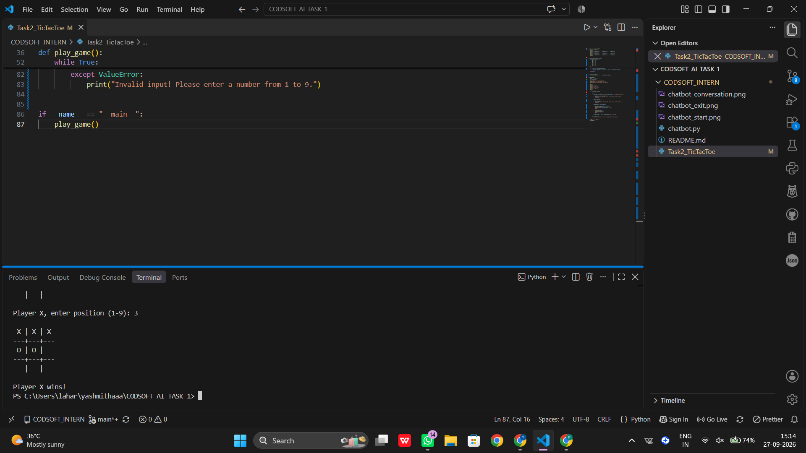
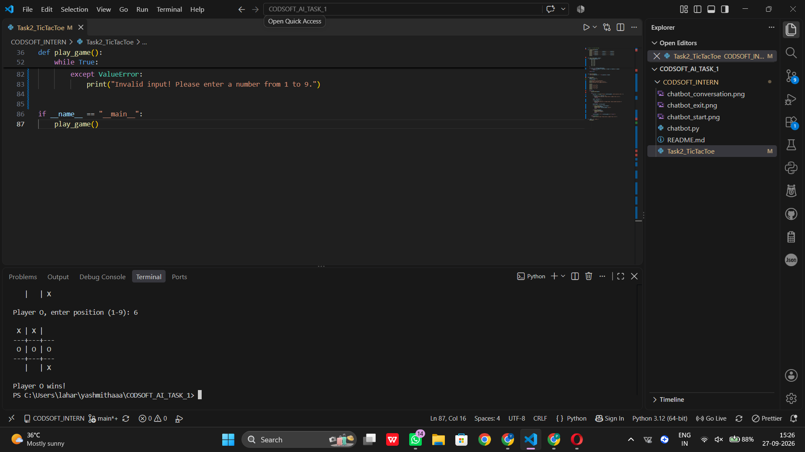
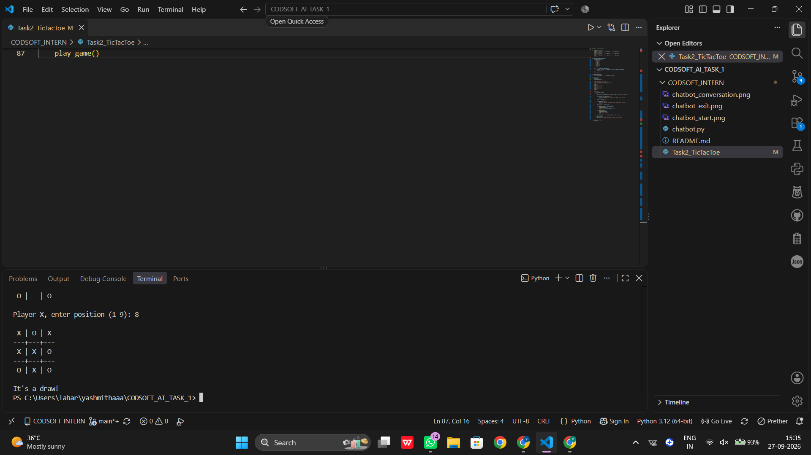

# Task 2 - Tic-Tac-Toe Game

## Project Description

This project is a simple two-player Tic-Tac-Toe game developed using Python.

The game allows two players to play against each other by entering positions from 1 to 9. The program checks for winning conditions, draw conditions, and invalid or repeated positions.

## Technologies Used

- Python
- VS Code

## Features

- Two-player Tic-Tac-Toe game
- Player X and Player O turns
- Winning condition detection
- Draw condition detection
- Invalid position handling
- Repeated position handling
- Simple command-line interface

## How to Run

1. Open the project in VS Code.
2. Open the `Task2_TicTacToe` Python file.
3. Run the program.
4. Enter a position from 1 to 9 when prompted.
5. Continue playing until a player wins or the game ends in a draw.

## Game Results

The program was tested successfully for:

- Player X winning
- Player O winning
- Draw condition
- Invalid position handling
- Repeated position handling
## Project Screenshots

### 1. Player X Wins

### 2. Player O Wins

### 3. Draw Condition

## Internship

This project was completed as **Task 2** of my Artificial Intelligence Internship at **CodSoft**.